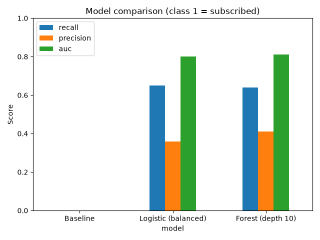
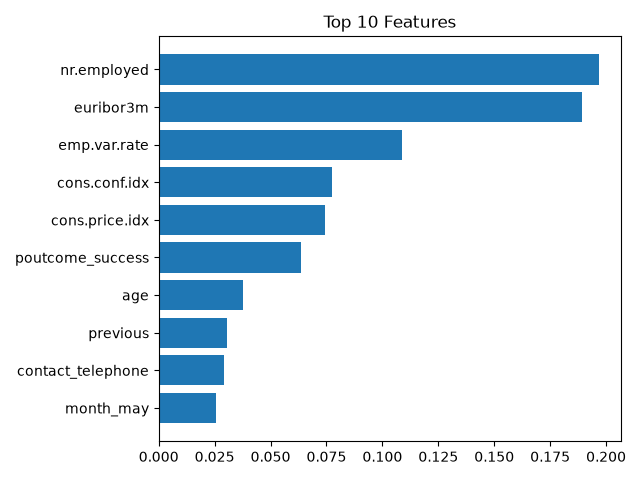
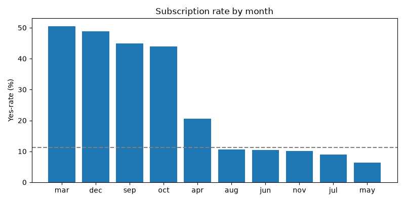

# Bank Marketing Prediction

Predicting whether a customer subscribes to a term deposit. I cleaned the data, built and compared models, and checked the results with SQL.
Data is from https://archive.ics.uci.edu/dataset/222/bank+marketing

## Data Cleaning:
- Removed Duration (Info is found after the call is over, would be data leakage)
- Removed Campaign (It counts the current call, info isn't fully known before the call)
- Removed pdays (Most pdays are 999, meaning N/A. poutcome and previous already have most of the same info)   
- Kept unknown as its own category to stay consistent and prevent guessing.
- Removed 12 duplicate rows
- Converted y/n to 1/0

| Model | Recall (yes) | Precision (yes) | ROC-AUC |
| :---: | :---: | :---: | :---: |
| Baseline (always "no") | 0.00 | undefined | 0.50 |
| Logistic regression (balanced) | 0.65 | 0.36 | 0.801 |
| Random forest, no depth limit | 0.47 | 0.40 | 0.769 |
| Random forest, depth 10 (balanced) | 0.64 | 0.41 | 0.812 |

Baseline: 88.7% accuracy by always predicting no

## Feature Importance: 
Top 5 are related to economics, which is interesting

## SQL Results
Yes Rate By:

Job:
| Job | # of People | Yes Rate (%) |
| :---: | :---: | :---: |
| Student | 875 | 31.4 |
| Retired | 1,718 | 25.3 |
| Unemployed | 1,014 | 14.2 |
| Admin | 10,419 | 13.0 |
| Unknown | 330 | 11.2 |
| Management | 2,924 | 11.2 |
| Technician | 6,739 | 10.8 |
| Self-employed | 1,421 | 10.5 |
| Housemaid | 1,060 | 10.0 |
| Entrepreneur | 1,456 | 8.5 |
| Services | 3,967 | 8.1 |
| Blue-collar | 9,253 | 6.9 |

Students are the highest, which indirectly shows younger people say yes more. Retired are second, both ends subscribe the most.

Month:

| Month | # of People | Yes Rate (%) |
| :---: | :---: | :---: |
| Mar | 546 | 50.5 |
| Dec | 182 | 48.9 |
| Sep | 570 | 44.9 |
| Oct | 717 | 43.9 |
| Apr | 2,631 | 20.5 |
| Aug | 6,176 | 10.6 |
| Jun | 5,318 | 10.5 |
| Nov | 4,100 | 10.1 |
| Jul | 7,169 | 9.0 |
| May | 13,767 | 6.4 |

Busier months have lower rates.

Previous Outcome:
| PoutCome | # of People | Yes Rate (%) |
| :---: | :---: | :---: |
| Success | 1,373 | 65.1 |
| Failure | 4,252 | 14.2 |
| Nonexistent | 35,551 | 8.8 |

Customers who subscribed in a previous campaign said yes 65% of the time

Age Group:
| Age Group | # of People | Yes Rate (%) |
| :---: | :---: | :---: |
| 65+ | 662 |47.3 |
| Under 25 | 1,067 | 24.0 |
| 25-34 | 13,684 | 12.2 |
| 50-64 | 7,391 | 11.6 |
| 35-49 | 18,372 | 8.4 |

## Overfitting: 
| Model | Train Accuracy | Test Accuracy |
| :---: | :---: | :---: |
| Forest, no depth limit | 0.98 | 0.86 |
| Forest, depth 10 | 0.855 | 0.857 |

## Ethics and Limitations
This data shows that students and people over 65 are more likely to say yes. This data describes real customers, but the data is public and anonymized. This data is from a Portuguese bank from around 2008 to 2010, which means this data may not apply to Canada today. 